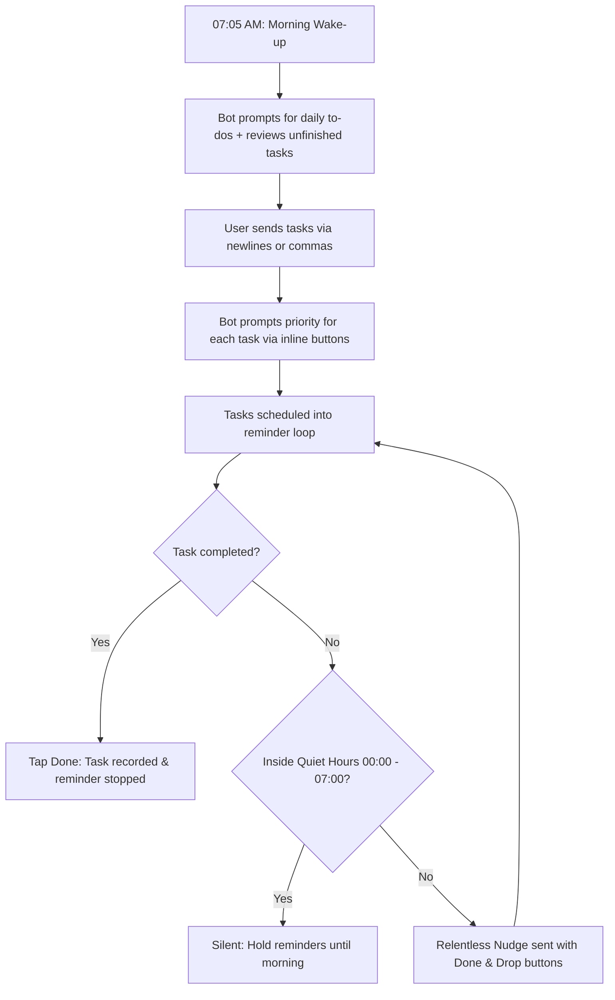

<div align="center">

# ⚡ RelentlessBot

**A self-hosted Telegram accountability bot that nags you until your daily tasks are actually completed.**  
*Zero friction. No snoozing. Relentless execution.*

[](https://www.python.org/)
[](cloudflare/README.md)
[](https://www.docker.com/)
[](https://www.sqlite.org/)
[](LICENSE)

[Features](#-key-features) • [Option A: Cloudflare Free Hosting](#-option-a-cloudflare-workers-100-free-forever) • [Option B: Docker Deployment](#-option-b-docker-deployment) • [Option C: Local Python](#-option-c-local-python-setup) • [Configuration](#-configuration) • [Contributing](#-contributing)

</div>

---

## 🎯 Why RelentlessBot?

Most to-do apps fail because they rely on you remembering to open them. **RelentlessBot reaches out to you where you already spend your time—on Telegram.**

Unlike traditional reminder apps that let you hit "Snooze" until tomorrow, **RelentlessBot has no snooze button**. Once a task enters your daily queue, it will continuously check in on you at an interval matching the task's importance until you either mark it **[ ✅ Done ]** or consciously **[ ❌ Drop ]** it.

---

## ✨ Key Features

- 📥 **Zero-Friction Ingestion**: Send tasks line-by-line or separated by commas. Paste anytime, whether morning or mid-day.
- 🔴🟡🟢 **Interactive Priority Setup**: 1-tap Telegram inline buttons to calibrate reminder frequency for every task.
- ⏰ **Dynamic Reminder Cadence**:
  - **🔴 High Priority**: Reminds every **45 minutes** (for crucial blockers & deadlines).
  - **🟡 Medium Priority**: Reminds every **90 minutes (1.5h)** (for normal daily goals).
  - **🟢 Low Priority**: Reminds every **150 minutes (2.5h)** (for routine errands).
- 🚫 **No Snooze Policy**: No excuses. The bot checks in persistently until the task is finished.
- 🌙 **Quiet Hours (12:00 AM – 7:00 AM)**: Completely silent during sleep hours. Pending reminders resume right at the start of your day.
- ☀️ **Morning Kickoff (7:05 AM)**: Wakes up, prompts you for today's to-do items, and offers to keep or clear yesterday's unfinished items.
- 🔒 **Private & Secure**: Built-in `ALLOWED_USER_IDS` whitelist prevents strangers from messaging or consuming your bot.
- 🛡️ **Multiple Deployments**: Host it **100% free on Cloudflare Workers (D1 SQLite)**, with **Docker**, or on your **local machine**.

---

## 🔄 Daily Lifecycle



---

## ☁️ Option A: Cloudflare Workers (100% Free Forever)

> **Recommended if you don't have a VPS or don't want to keep your computer turned on.** Runs 24/7 on Cloudflare's global edge network using Cloudflare D1 (Serverless SQLite).

```bash
cd cloudflare

# 1. Install dependencies & log into Cloudflare
npm install
npx wrangler login

# 2. Create your free serverless database
npx wrangler d1 create relentless-db
# Copy the printed database_id into cloudflare/wrangler.toml

# 3. Initialize tables & store your bot token
npx wrangler d1 execute relentless-db --file=./schema.sql
npx wrangler secret put BOT_TOKEN

# 4. Deploy!
npx wrangler deploy
```

Then open `https://relentless-bot.<your-subdomain>.workers.dev/set-webhook` in your browser to link Telegram to your worker in 1-click!

*For detailed step-by-step instructions, see the [Cloudflare Setup Guide](cloudflare/README.md).*

---

## 🐳 Option B: Docker Deployment

Run 24/7 on your home server, VPS, or Raspberry Pi with a single command:

```bash
# 1. Copy environment template and set your token
cp .env.example .env

# 2. Run container
docker compose up -d
```

To view logs:
```bash
docker compose logs -f
```

---

## 💻 Option C: Local Python Setup

```bash
# 1. Create and activate virtual environment
python -m venv .venv

# On Linux/macOS:
source .venv/bin/activate
# On Windows:
.venv\Scripts\activate

# 2. Install dependencies
pip install -r requirements.txt

# 3. Configure environment
cp .env.example .env

# 4. Run the bot
python main.py
```

---

## ⚙️ Configuration Reference

All settings can be customized in `.env` (for Docker/Python) or `wrangler.toml` (for Cloudflare):

| Variable | Default | Description |
| :--- | :--- | :--- |
| `BOT_TOKEN` | *Required* | Telegram API token from @BotFather |
| `ALLOWED_USER_IDS` | `""` | Comma-separated user IDs allowed to interact. If empty, anyone can use it. |
| `TIMEZONE` | `Asia/Kolkata` | Your timezone (e.g., `UTC`, `America/New_York`, `Europe/London`). |
| `QUIET_HOURS_START` | `00:00` | 24-hr time when reminders pause (Midnight). |
| `QUIET_HOURS_END` | `07:00` | 24-hr time when reminders resume (7:00 AM). |
| `MORNING_PROMPT_TIME` | `07:05` | Time when bot asks for today's new task list. |
| `HIGH_PRIORITY_INTERVAL_MINUTES` | `45` | Interval for High priority tasks. |
| `MEDIUM_PRIORITY_INTERVAL_MINUTES` | `90` | Interval for Medium priority tasks (1.5h). |
| `LOW_PRIORITY_INTERVAL_MINUTES` | `150` | Interval for Low priority tasks (2.5h). |
| `DB_PATH` | `data/relentless.db`| SQLite database file location (Docker/Python). |

---

## 🎮 How to Use

### Adding Tasks Anytime
Send a message in any of these formats:

**Newline format:**
```text
Deploy staging backend
Draft API documentation
Order gym supplements
```

**Comma-separated format:**
```text
Deploy staging backend, Draft API documentation, Order gym supplements
```

**Numbered / Bullet format:**
```text
1. Deploy staging backend
2. Draft API documentation
- Order gym supplements
```

RelentlessBot will immediately prompt you with inline buttons to assign priorities.

### Bot Commands
- `/tasks` or `/list` — View active tasks grouped by priority with 1-tap complete buttons.
- `/clear` or `/reset` — Clear all pending tasks or wipe completed history.
- `/help` — Overview of syntax, intervals, and commands.
- `/start` — Welcome message and instructions.

---

## 🧪 Running Tests (Python)

The test suite validates parser edge cases, database persistence, and quiet-hours schedule calculations:

```bash
python -m unittest tests/test_core.py
```

---

## 🤝 Contributing

Contributions, feature ideas, and pull requests are warmly welcomed!
1. Fork the Project
2. Create your Feature Branch (`git checkout -b feature/AmazingFeature`)
3. Commit your Changes (`git commit -m 'Add some AmazingFeature'`)
4. Push to the Branch (`git push origin feature/AmazingFeature`)
5. Open a Pull Request

---

## 📄 License

Distributed under the **MIT License**. See `LICENSE` for details.

---

<div align="center">
Built with determination by <a href="https://github.com/rehan1020">rehan1020</a>.
</div>
